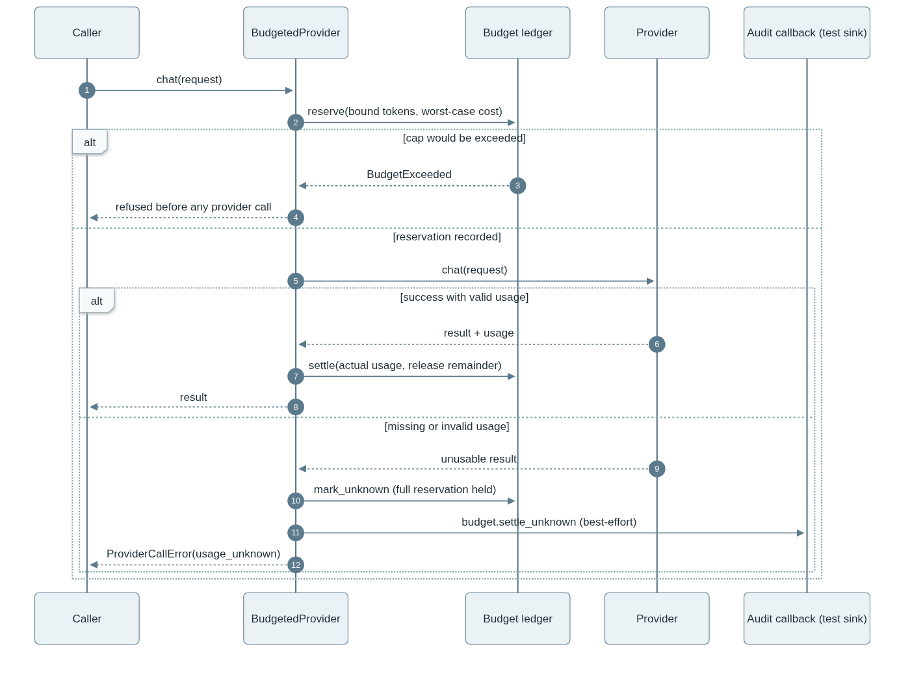
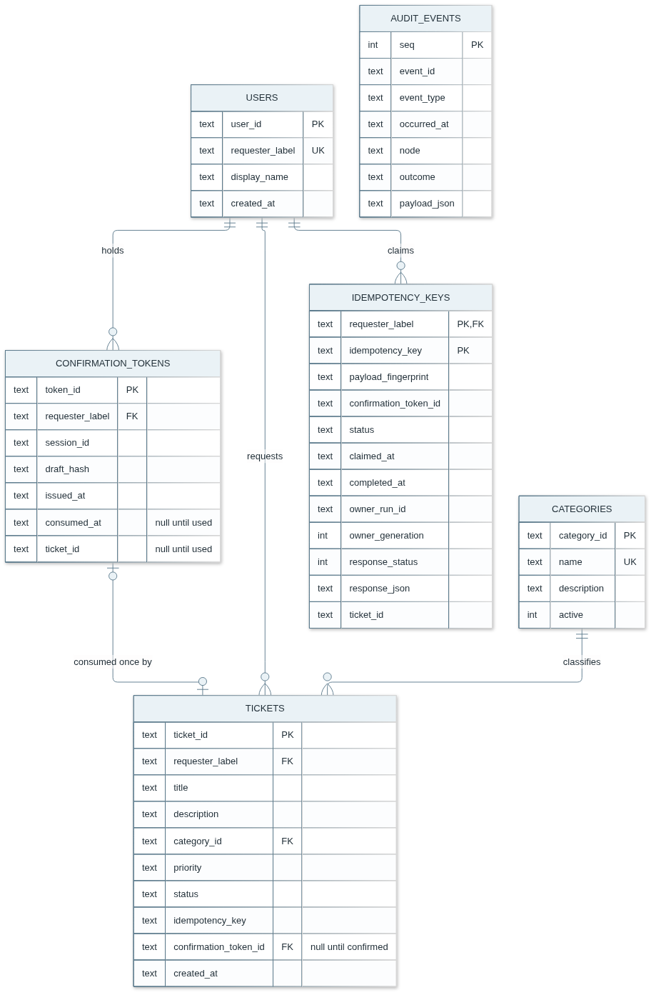

# ServiceDesk Copilot

A local-only, single-user prototype of a policy-constrained IT support copilot. The project explores building LLM-assisted ticket handling where the safety controls are first-class, tested code rather than policy documents. Everything runs on one machine against synthetic data. The app binds to loopback by design and refuses a wider listen host at startup; it is not deployed or authenticated.

## What it explores

- **Fail-closed provider gating.** A registry admits exactly one provider. The hosted adapter is built and disabled by default; with an empty pricing catalog it refuses to call.
- **Budget reservation accounting.** A budget wrapper reserves worst-case cost in an OS-locked JSON ledger before any provider call, settles the reservation from actual usage, and discards a result whose usage is missing or untrustworthy, holding the reservation as unknown.
- **Confirmation and idempotency in the schema.** Ticket writes are designed around single-use confirmation tokens and idempotency keys, enforced by unique constraints and an atomic conditional update, exercised by concurrent-claim tests. The route that wires them to the mock ticket service is the next build gate.
- **Browser write guards.** The stub write route requires the session cookie, a custom header, a same-origin check and a CSRF token; each guard is tested individually and in combination.
- **Append-only audit.** An audit module writes to a table sealed against UPDATE and DELETE by SQLite triggers.
- **Probing tests.** 325 tests pass with 1 skipped, covering concurrent token claims, backup under the instance lock, and log redaction through the real logging pipeline.

## Components


The wired application today is deliberately small: an app factory that validates configuration at construction, a session bootstrap route, health, readiness, and metrics endpoints, and one stub write route that exists to exercise the write guards. The provider registry, budget wrapper, and audit writer are built and tested as library modules. Wiring them to the mock ticket routes is the next gate.

## Budgeted provider call



This flow is implemented and tested as a library module. It is not wired to any route yet.

## Data model



Six tables in a single SQLite database (WAL, STRICT, foreign keys on). A ticket's confirmation_token_id is nullable and set when a ticket is created with a confirmation token; its idempotency_key is a recorded reference, not an enforced foreign key. audit_events is append-only by trigger.

## Stack

Python 3.13, FastAPI, uvicorn, pydantic, SQLAlchemy and Alembic, SQLite, httpx, prometheus-client. Development tooling: pytest, ruff, mypy. Dockerfile and docker-compose are authored and statically checked only.

## Status

Built and tested: configuration with loopback enforcement and single-instance locking, structured logging with redaction, the app factory, session bootstrap, health, readiness, and metrics, the stub write route behind the four write guards, the six-table schema and migrations, online backup, the audit module, the provider registry with fake and hosted adapters, and the budget wrapper with its ledger.

Not built: the mock ITSM service and the ticket-create route (Gate B6), and the agent loop with knowledge-base retrieval (Phase P1). docker-compose references the future ITSM module, so it does not run end to end yet.

## Honest limits

- Single user, unauthenticated by design. The session cookie is not an identity, and all data is synthetic.
- A provider result without trustworthy usage is discarded and its reservation stays held; recording that outcome is best-effort, not audit-complete.
- Budget caps and pricing are adopted at process start.
- No readiness claim for any environment, workload, or scope.

## Development

Setup steps (not smoke-tested on a fresh machine):

```
python -m venv .venv
.venv\Scripts\pip install -r requirements-dev.txt
.venv\Scripts\pytest
```

Layout:

```
app/        config, logging, db, audit, security, providers, embeddings, routes
alembic/    migration environment, revision 0001
scripts/    migrate and backup wrappers
tests/      unit, integration, and concurrency tests
config/     pricing catalog (empty by default; hosted mode refuses calls)
```

## License

No license file yet.
