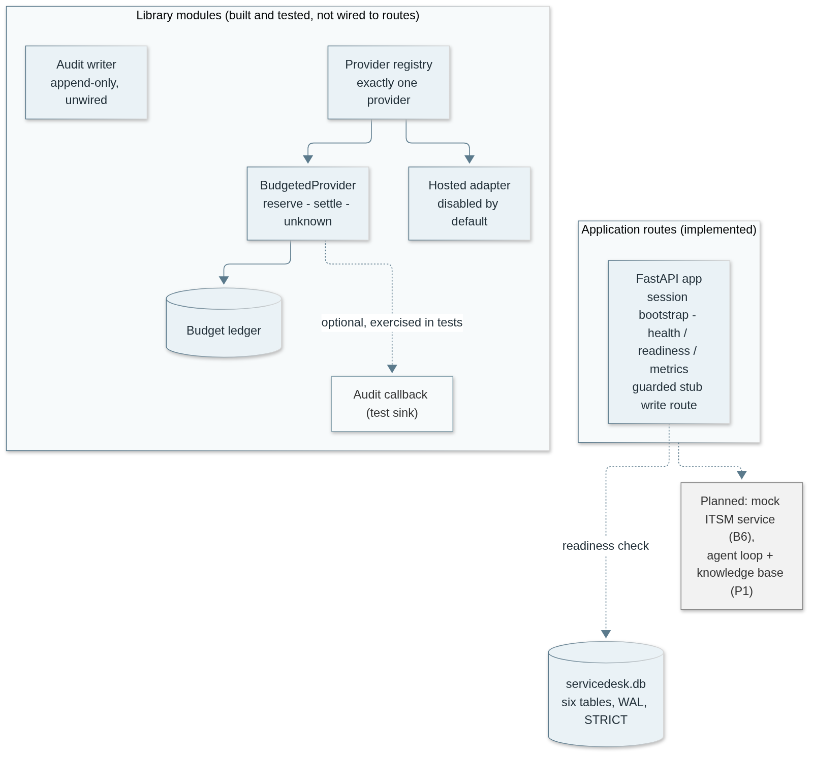

# ServiceDesk Copilot

A local-only, single-user prototype of a policy-constrained IT support copilot. The project explores building LLM-assisted ticket handling where the safety controls are first-class, tested code rather than policy documents. Everything runs on one machine against synthetic data. The app binds to loopback by design and refuses a wider listen host at startup; it is not deployed or authenticated.

## Status

Nothing is deployed, qualified or measured. No readiness claim is made for any
environment, workload or scope, and the phrase is not used unscoped anywhere in
this repository. The project is under construction: Gate 1 adds a deterministic
cited-answer read path and a confirmed ticket-creation slice, not a complete
copilot. Phase estimates in the design plan are unvalidated planning numbers.

Built and tested locally: configuration with loopback enforcement and single-instance locking, structured logging with redaction, the app factory, session bootstrap, health, readiness, and metrics, the stub write route behind the four write guards, the six-table schema and migrations, online backup, the audit module, the provider registry with fake and hosted adapters, the budget wrapper with its ledger, deterministic lexical retrieval with citation checks, and the ticket confirmation and creation routes with a local in-process stand-in.

Not built: a real ITSM service or client, the full agent loop, embeddings and a vector store, and hosted model use beyond that one sample. The optional ticket-draft route has been exercised once against a hosted provider (one synthetic message on 2026-11-27); that single sample is not evidence of reliability or accuracy. docker-compose still references the future ITSM module, so it does not run end to end.

## What it explores

- **Fail-closed provider gating.** A registry admits exactly one provider. The hosted adapter is built and disabled by default; with an empty pricing catalog it refuses to call.
- **Budget reservation accounting.** A budget wrapper reserves worst-case cost in an OS-locked JSON ledger before any provider call, settles the reservation from actual usage, and discards a result whose usage is missing or untrustworthy, holding the reservation as unknown.
- **Confirmation and idempotency in the schema.** Ticket writes are designed around single-use confirmation tokens and idempotency keys, enforced by unique constraints and an atomic conditional update, exercised by concurrent-claim tests. The routes that wire them to the local in-process stand-in are built; a real ITSM client is not.
- **Browser write guards.** The stub write route requires a session identifier, a custom header, a same-origin check and a CSRF token; each guard is tested individually and in combination.
- **Append-only audit.** An audit module writes to a table sealed against UPDATE and DELETE by SQLite triggers.
- **Probing tests.** Local tests cover concurrent token claims, backup under the instance lock, and log redaction through the real logging pipeline. The dated local result is under Checks and evidence.

## What exists now

- Six synthetic hardware/printing articles in `data/kb/printing/`, described by
  the frozen `data/fixtures/manifest.json`.
- Deterministic lexical retrieval over section-sized chunks, with a
  positive-evidence threshold and one stable answer or fixed refusal. The answer
  text is an extract, not generated prose.
- `POST /chat` and the `ask` CLI. The request is
  `{"message": "...", "conversation_id": "optional UUID"}`. The response carries
  `reply`, `citations`, `proposed_action: null` and `state`. An answer is a fixed
  frame around a verbatim excerpt plus one citation: article ID, version,
  section and exact character span. A refusal returns no citation.
- Manifest verification at first ask: SHA-256, byte length, path containment and
  duplicate identity. The verified snapshot is cached immutably for the process
  lifetime.
- One durable `chat.answer` or `chat.refusal` audit row per chat turn, written
  in the caller-owned transaction. The endpoint is not zero-write.
- Existing B0 to B5 pieces: configuration, structured logs, SQLite schema and
  migration wrapper, loopback Host/Origin guards, sessions, health/readiness and
  base metrics.

## Components



The wired application now includes an app factory that validates configuration at construction, a session bootstrap route, health, readiness, and metrics endpoints, the stub write route, the chat read path, and the ticket confirmation and creation routes. The provider registry, budget wrapper, and audit writer remain library modules; the ticket routes use a local in-process stand-in, not a real ITSM service.

## Budgeted provider call


This flow is implemented and tested as a library module. It is reachable only through the optional ticket-draft route, which the demo and the tests exercise with the fake provider, and which was run once against a hosted provider on 2026-11-27.

The hosted adapter sends `max_completion_tokens` and `reasoning_effort: none`, and no
longer sends `temperature`, following the OpenAI Chat Completions reference read on
27 November 2026. `config/pricing.yaml` now has a `gpt-6-luna` entry under provider
`openai`, sourced from the OpenAI pricing page read on 27 November 2026; prices can
change. One hosted call has been made on 2026-11-27, with model `gpt-6-luna`, one
synthetic message and run `live-1`: the request was accepted and the reply parsed
into a draft, and the local ledger recorded 64 prompt and 37 completion tokens,
about $0.000025. That is a single sample and says nothing about accuracy,
reliability, latency, other models or real tickets. Hosted calls remain off by
default and still need the gate settings, an approval file and a key at run time.

## Data model


Six tables in a single SQLite database (WAL, STRICT, foreign keys on). A ticket's confirmation_token_id is required and references confirmation_tokens; its idempotency_key is a recorded reference, not an enforced foreign key. audit_events is append-only by trigger.

## Stack

Python 3.13, FastAPI, uvicorn, pydantic, SQLAlchemy and Alembic, SQLite, httpx, prometheus-client. Development tooling: pytest, ruff, mypy. Dockerfile and docker-compose are authored and statically checked only.

## Run the local slice

These are the intended Windows commands, documented from the source and not
executed for this README. Run them from the repository root.

```powershell
py -3.13 -m venv .venv
.venv\Scripts\python -m pip install -r requirements-dev.txt

# Create or upgrade runtime/servicedesk.db and record the migration audit event.
.venv\Scripts\python -m scripts.migrate

# Add the local requester and the Hardware category the ticket routes need.
.venv\Scripts\python -m scripts.seed_demo

# Run the app on the loopback host and port the Host guard expects.
.venv\Scripts\python -m uvicorn app.main:create_app --factory --host 127.0.0.1 --port 8000

# In another terminal, ask a supported and an unsupported question.
.venv\Scripts\python -m app.cli ask "my printer shows offline"
.venv\Scripts\python -m app.cli ask "how do I bake sourdough bread"
```

If `.venv` already exists, skip the first two commands. `scripts.migrate`
defaults to `runtime/servicedesk.db`, creates the parent directory and the
database on first run, and records a skipped backup when the source does not
exist yet. `scripts.backup` is available for an existing database. The app does
not migrate at startup, so run `scripts.migrate` before the first `/chat`.
`SDC_DATABASE_PATH` overrides the database file but must resolve inside
`SDC_RUNTIME_DIR` (default `runtime/`). If you set `SDC_LISTEN_HOST` or
`SDC_LISTEN_PORT`, pass the same host and port to uvicorn; the defaults are
`127.0.0.1:8000`. The install step needs access to your configured package
index. If `py -3.13` is not available, use your Python 3.13 executable in place
of it.

### Demo the ticket flow

With the seed applied and the server running, these commands get a session,
confirm a draft and create the ticket.

```powershell
$session = Invoke-RestMethod -Method Post -Uri 'http://127.0.0.1:8000/api/session'
$headers = @{ 'x-sdc-session' = $session.session_id; 'x-sdc-csrf' = $session.csrf_token }
$draft = @{ title = 'Printer offline'; category = 'hardware'; priority = 'normal'; description = 'The office printer shows offline.' }
$confirm = Invoke-RestMethod -Method Post -Uri 'http://127.0.0.1:8000/api/ticket-confirmations' -Headers $headers -ContentType 'application/json' -Body (@{ draft = $draft } | ConvertTo-Json -Depth 4)
$key = [guid]::NewGuid().ToString()
$ticket = Invoke-RestMethod -Method Post -Uri 'http://127.0.0.1:8000/api/tickets' -Headers ($headers + @{ 'Idempotency-Key' = $key }) -ContentType 'application/json' -Body (@{ draft = $draft; confirmation_token = $confirm.confirmation_token } | ConvertTo-Json -Depth 4)
$ticket
```

Read the ticket and audit rows back with the same Python:

```powershell
.venv\Scripts\python -c "import sqlite3; c = sqlite3.connect('runtime/servicedesk.db'); print(c.execute('select ticket_id, requester_label, title, category_id, priority, status from tickets').fetchall()); print(c.execute('select event_type, outcome, payload_json from audit_events order by seq').fetchall())"
```

These commands were written from the routes and were not run by the test
suite. The path is local only: it uses the in-process stand-in, not a real
ITSM, and makes no model call. The seed adds only the local requester and the
Hardware category; it does not create the database.

### Draft a ticket with a model (optional)

`POST /api/ticket-drafts` takes `{"message": "..."}` with the session and CSRF
headers and returns a validated draft. In `ci_fake` and `demo_fake` mode the
route returns the same fixed scripted draft whatever the user types; that draft
is a scripted fixture, not model output, and is not evidence of model quality.
The provider may supply only a title, a description and a category suggestion.
The route validates them with the same draft validation and active-category
lookup the ticket routes use, and priority stays `normal`. The route never
creates a ticket, a confirmation token or an idempotency key. Confirmation and
creation are unchanged and remain the only write path.

Hosted mode is off by default. It needs `SDC_MODE=hosted`, an explicit
`SDC_ALLOW_HOSTED_CALLS=true`, a per-run approval file, a provider name, model
and base URL, a token counter and `SDC_HOSTED_API_KEY`. `config/pricing.yaml` holds
one entry, `openai` / `gpt-6-luna`; any other provider or model has no price and
hosted mode fails closed before a client is built.

The provider would see the ticket text, so use synthetic text only. A provider
failure or a budget-ledger file or lock failure returns a fixed 503, and invalid
or non-JSON model output returns a fixed 422 `invalid_draft`; no response echoes
model text, a key or provider detail. No prompt or completion is logged.

## Check and stop the local server

With the server running, check liveness and readiness:

```powershell
Invoke-WebRequest -Uri 'http://127.0.0.1:8000/healthz' -NoProxy -TimeoutSec 5 -UseBasicParsing
Invoke-WebRequest -Uri 'http://127.0.0.1:8000/readyz' -NoProxy -TimeoutSec 5 -UseBasicParsing
```

`/healthz` returned HTTP 200 with `{"status":"alive","version":"0.0.0"}` in the demo. `/readyz` returned HTTP 200 with `status: ready`, `mode: ci_fake`, `checks.db.status: ok`, `checks.db.detail: write_probe_rolled_back`, `checks.vector_store.status: not_configured`, `checks.provider.status: not_required` and `checks.provider_upstream.status: unverified`. Readiness is a bounded local check; it does not prove the schema revision or that `/chat` can write audit rows. Use `/healthz`, not `/health`; `/health` is not a route and returns 404.

The server binds loopback only. The Host guard expects the same host and port as `SDC_LISTEN_HOST` and `SDC_LISTEN_PORT` (defaults `127.0.0.1:8000`).

The demo was stopped with `taskkill /PID <launcher-pid> /T /F` after `taskkill` without `/F` was refused for the console process. That is a force stop, not a graceful shutdown, and it does not prove lifespan disposal. Stop only the process tree you started.

The database uses WAL. While it is open, SQLite may create `servicedesk.db-wal` and `servicedesk.db-shm` beside `runtime/servicedesk.db`. Both appeared after the read-only audit check in the demo. Do not delete them while a process may have the database open.

## Knowledge base and citations

This slice supports only the fixed `<repo>/data/kb` shape. `Settings.kb_dir`
defaults there, the loader derives the project root as two levels above it, and
manifest entries are project-relative paths such as
`data/kb/printing/PRN-001.md`. A relocated KB is not supported.

The manifest is verified once, on the first ask, and cached as an immutable
snapshot. Restart the process to pick up changed article content or a changed
manifest. A missing or invalid KB returns 503 `kb_unavailable`; a missing or
unmigrated audit database returns 503 `audit_unavailable`. There is no automatic
repair script.

Citation checks prove identity, version and exact span against the verified
snapshot. They do not prove that the cited text answers the question correctly
or that the troubleshooting content is company policy. The six articles are
synthetic demo content, not vendor guidance.

## Checks and evidence

Local results reported on 27 November 2026 in this tree: Ruff check and format
passed; the full suite passed 449 tests with one Windows filename skip. The full
run was done with the local demo database `runtime/servicedesk.db` renamed aside,
not deleted and not opened, because three existing tests assert that path does
not exist and failed while it was present. These are local results, not a CI
result. CI runs Ruff check and format plus the three B0 modules,
`tests/test_exposure_config.py`, `tests/test_config.py` and
`tests/test_logging_redaction.py`, and the ticket modules
`tests/test_audit_schema.py`, `tests/test_ticket_create.py`,
`tests/test_demo_seed.py` and `tests/test_ticket_draft.py`; it does not run the
Gate 1 chat, KB or citation tests, the lifespan test, or a migration. Full pytest
is not part of CI. The GitHub workflow runs on push; this README does not record
its result. The pytest-asyncio
fixture-loop-scope warning and the Starlette/httpx deprecation warning remain.
The lifespan test asserts that the app-owned audit engine is disposed on
shutdown; it uses a recording engine, so it proves the lifespan wiring, not real
connection-pool behavior.

There is no installed pre-commit hook in this checkout.
`.pre-commit-config.yaml` is configuration only; its presence is not active
enforcement.

```powershell
.venv\Scripts\ruff.exe check --no-cache .
.venv\Scripts\ruff.exe format --check --no-cache .
.venv\Scripts\python -m pytest
```

### Ticket creation (local slice)

- `POST /api/ticket-confirmations` issues a single-use token bound to the draft
  hash, the local requester and the session. `POST /api/tickets` consumes it once,
  in one immediate transaction, and replays the stored ticket for the same key
  and draft.
- Proven locally: draft validation and hashing, token binding, one create,
  same-key replay, draft-change and consumed-token rejects, rollback on audit or
  late failure, locked-store 503, and no token or draft text in audit payloads.
- Not proven: racing creates, a crash between commit and reply, a live in-flight
  409, fencing, a startup sweep, invalid-JSON or empty-body problem bodies (still
  the framework default 422), the internal ITSM listener, or any real ITSM call.
- Known limits: a same-key replay is scoped to the local requester, not the
  session. A retry with the same key and the same draft returns the stored ticket
  from a different session. This is tested with a fresh app instance on the same
  database, not a real process restart. The adapter is a local in-process
  stand-in, not an ITSM.
- Category: matched by name, ignoring case and outer spaces. Case folding is
  ASCII only, as read from the code and not tested. A category switched off
  before create refuses the create and leaves the confirmation unused. A rename
  is not tested. Category IDs are not accepted.
- CI runs the three B0 modules plus `tests/test_audit_schema.py`,
  `tests/test_ticket_create.py`, `tests/test_demo_seed.py` and
  `tests/test_ticket_draft.py`. Full pytest is not part of CI.

## Limits

- Requester labels and confirmation tokens, when they exist, are scoping and
  confirmation conveniences, not identity or authority.
- Gate 1 chat audit rows leave `requester_label` and `duration_ms` NULL: the
  `/chat` contract carries no requester label and the chat path does not measure
  per-turn duration. Both audit columns are optional.
- One hosted model call was made on 2026-11-27 (one synthetic message, run live-1).
  Hosted mode remains off by default and is not part of Gate 1.
- The optional ticket-draft route returns a scripted draft in `ci_fake` and
  `demo_fake` mode whatever the user types. It proves the route, the guards and
  the validation, not model output. The provider would see the ticket text, so
  use synthetic text only. `config/pricing.yaml` has one `gpt-6-luna` entry, so any
  other model fails closed.
- The prompt-token bound used before a hosted call is the UTF-8 byte count plus
  a fixed per-message margin. A token is at least one byte, so the bound should
  not undercount, but the margin is an assumption, not a tokenizer measurement.
- Gate 1 adds a local ticket, token and idempotency slice (see the Ticket
  creation section above), but no real ITSM write and no real model, embedding
  or held-out benchmark.
- `/readyz` reports bounded local conditions only. It does not prove the schema
  is migrated or that `/chat` can write audit rows.
- `InstanceLock` exists in `app/config.py` but the app factory does not acquire
  it. Run one process.
- Docker and Compose remain an authored scaffold, not a Gate 1 runnable path.
  The image does not include `data`, `alembic` or `scripts`, and Compose still
  references the B6 ITSM module. No image is built or started.
- A provider result without trustworthy usage is discarded and its reservation stays held; recording that outcome is best-effort, not audit-complete.
- Budget caps and pricing are adopted at process start.
- Single user, unauthenticated by design. The session identifier is not an identity, and all data is synthetic.
- The single hosted call on 2026-11-27 shows that one request was accepted and parsed, and that the ledger settled it at about $0.000025. It does not show accuracy, reliability, latency, cost at other sizes, other models, or behaviour on real ticket text, and its figures were not compared with the provider's own billing.

## Decision notes

These notes record earlier gate decisions; they are not a current build status.

1. **B1 (schema/migrations):** drop the `ux_tokens_single_consumption` index
   from the Revision 1 schema. `token_id` is already the primary key, so the
   pair index enforces nothing. The single-use guarantee is the atomic
   `UPDATE ... WHERE consumed_at IS NULL` plus `ux_tickets_token`. Also add the
   missing foreign key `tickets.confirmation_token_id REFERENCES
   confirmation_tokens(token_id)`. Not built in B0.

2. **B5 (budget bound):** the Revision 1 wording "a count the provider itself
   reported for the identical request shape" is not a valid bound. An identical
   shape with different content can have a different token count. A
   provider-reported count is valid only for a byte-identical re-send of the
   exact same request content, which is the retry case. First-time requests need
   the provider's count endpoint or a model-pinned tokenizer, or hosted mode
   fails closed. Not built in B0.

3. **B0a (environment):** two provider variables were present in the OpenCode
   shell at B0. Project commands ran in a scrubbed child environment that
   removes those two names by name only; the parent and saved environment were
   not modified.

4. **B0 repair (lock ownership and log extras):** `InstanceLock` now takes
   ownership from an OS advisory lock held on an open descriptor
   (`msvcrt.locking` on Windows, `fcntl.flock` on POSIX). Byte 0 is a lock cell
   that is never written; the diagnostic record is a fixed 96-byte cell at
   offset 1, overwritten in place, and the file is never truncated or deleted.
   A crash releases the lock in the kernel, so stale text cannot wedge a
   restart. Never fork while holding the lock. The POSIX branch is not exercised
   by any run yet. Structured log extras (`event`, `outcome`, `request_id`,
   `session_id`) accept exact builtin scalars only: strings are redacted,
   booleans, integers and finite floats pass through, and everything else
   becomes the constant `[REJECTED]`, so an arbitrary object's `__str__` is
   never called.

5. **B1 (schema and migrations):** migration `0001` creates the six-table
   schema as amended by note 1, with every table `STRICT` and every `TEXT`
   primary key declared `NOT NULL`. `audit_events` is append-only by trigger
   (`trg_audit_no_update`, `trg_audit_no_delete`), not merely by convention.
   The database path is owned by `Settings`: `SDC_DATABASE_PATH`, defaulting to
   `<runtime>/servicedesk.db`, and an override is validated to resolve inside
   the runtime directory. Connections use WAL, `foreign_keys=ON` and a 5 s busy
   timeout through one shared helper; under WAL, plain file copy is **not** a
   valid backup, and the later backup gate must use the SQLite online backup
   API.

6. **B1b (backup and migration wrapper):** backups use the SQLite online backup
   API only, from a `mode=rw` URI built with `Path.as_uri()`, so a missing source
   is never created. The artifact is finalized to `journal_mode=DELETE`, opened
   read-only for `PRAGMA integrity_check` and the schema revision, then hashed;
   the SHA-256 and size are recorded in `<artifact>.manifest.json`. That is
   snapshot verification, **not** proof of content equivalence with a changing
   source, and `integrity_check` is not a proof of semantic correctness; the
   restore drill remains a later gate. The copy deadline is cooperative, checked
   before the copy and between page chunks; it is not a wall-clock guarantee,
   and finalization, verification and hashing are outside it. Standalone backup
   may run against a live database; **schema migration must run in a maintenance
   window with all other writers stopped**. The wrapper's persistent
   `<database>.migrate.lock` serialises cooperating manual wrappers on one local
   filesystem only: it cannot stop arbitrary SQLite clients, direct Alembic runs
   or an application that does not honour it, and its presence alone is never
   ownership. First run skips the backup with a recorded reason and creates the
   schema. Backups and lock files are retained; there is no rotation or cleanup.
   SQLite itself may create, rewrite and remove its own journal/WAL/SHM support
   files, including while the artifact is finalized to DELETE mode; no project
   code or test deletes a database, artifact, manifest, lock file or directory.

## Development

Setup is described in Run the local slice above.

Layout:

```
app/        config, logging, db, audit, security, providers, embeddings, chat, tickets, health, session
alembic/    migration environment, revision 0001
scripts/    migrate and backup wrappers
tests/      unit, integration, and concurrency tests
config/     pricing catalog (one gpt-6-luna entry; other models refuse)
```

## License

No license file yet.
